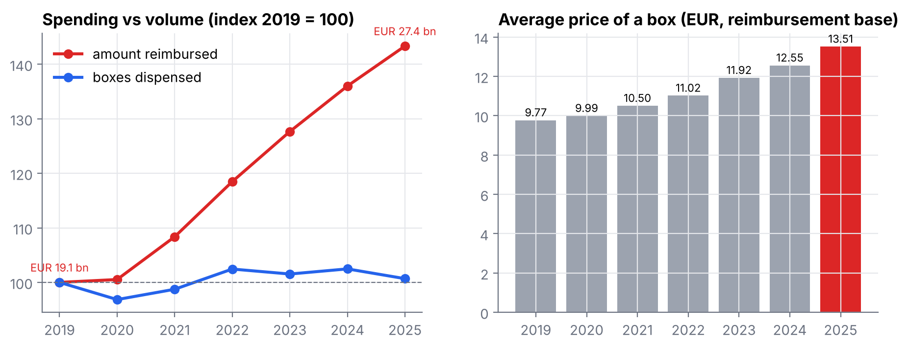

# What France reimburses: medicines dispensed in pharmacies, 2019–2025

An analysis of **€160 billion** of medicines reimbursed by French health insurance between 2019 and 2025,
using Open Medic, the national open dataset built from the French health data system (SNDS).

**Read the [report (PDF)](report/report.pdf)** · browse the [notebook](notebooks/medicine_spending.ipynb) · SQL in [`sql/`](sql/)



## Key findings

| | |
|---|---|
| **Price, not volume** | Reimbursements rose **+43%** (€19.1 bn → €27.4 bn) while boxes dispensed stayed flat (+1%). The average box went from €9.77 to €13.51. |
| **Where it went** | Cancer and immunology drugs account for €3.2 bn of the €8.3 bn increase. |
| **A new number one** | Tafamidis (heart amyloidosis) went from €45 m to €1,071 m: the most reimbursed molecule in 2025, for about 16,000 patients. |
| **Concentration** | Half of all spending now comes from 55 molecules out of ~1,100 (70 in 2019). |
| **GLP-1 analogues** | Patients more than doubled, from 415,000 (2020) to 932,000 (2025), led by semaglutide. |
| **Antibiotics** | Patients fell 17% in 2020 (−25% for under-20s) and were back to the 2019 level in 2024. |
| **ADHD** | Adults treated with methylphenidate went from 17,000 to 114,000 (×6.8). |
| **Regions** | After age standardisation, Île-de-France moves from 11th to 3rd; Grand Est ranks 4th of 12. |

## What the project shows

* **Data engineering**: 22 files with French number formats (`1.171,74`) and mixed encodings (Windows-1252 and UTF-8),
  normalised and loaded into **DuckDB**.
* **Entity resolution**: the same molecule appears under several ATC codes (WHO reclassifications in 2020–2021) and
  spellings; a union-find on (code, label) pairs builds stable molecules, covering 19% of spending.
* **Validation**: totals computed from three levels of detail match to the euro.
* **SQL**: window functions (`LAG`, `rank`, running sums), `FILTER` aggregates, `QUALIFY`, CTEs.
* **Statistics**: price/volume split, concentration, direct age standardisation for fair regional comparisons.

## Project structure

```
src/download.py        download Open Medic (token-protected links), INSEE population, region shapes
src/build_db.py        encodings -> UTF-8, SQL cleaning, population, molecule linking -> data/medicines.duckdb
sql/01_clean.sql       raw files -> typed tables (atc5, atc4, atc2, labels)
sql/02_views.sql       analysis views (molecules, yearly totals, region x age)
src/analysis.py        one function per question, writes figures/ and results/
src/make_notebook.py   builds and executes the notebook
report/report.pdf      the written report
```

## Reproduce

```bash
pip install -r requirements.txt
python run_all.py          # about 2 minutes
```

## Data

* Assurance Maladie, *Open Medic*, files "NB" by ATC level × age group × sex × region, 2019–2025 (data.gouv.fr).
  Scope: medicines dispensed by retail pharmacies and reimbursed by all schemes; hospital medicines are not included.
  Amounts exclude pharmacists' dispensing fees.
* INSEE, *Estimation de la population au 1er janvier*, by region, sex and age (2019–2023; 2023 reused for 2024–2025).
* Region boundaries: [france-geojson](https://github.com/gregoiredavid/france-geojson).

Author: Deo Gratias Loutou — [portfolio](https://ldgkm.github.io) · [LinkedIn](https://www.linkedin.com/in/deo-gratias-loutou-545263278)
